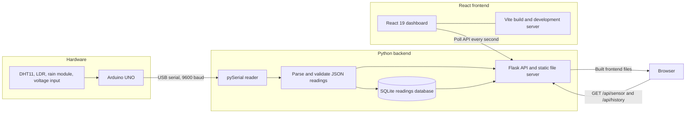
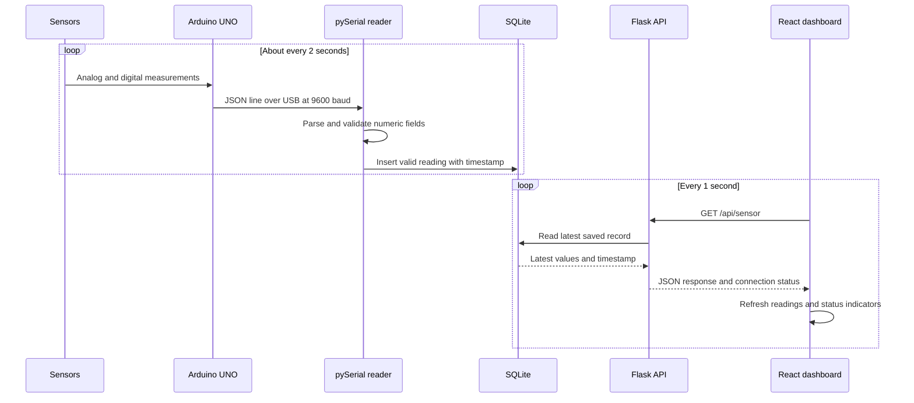
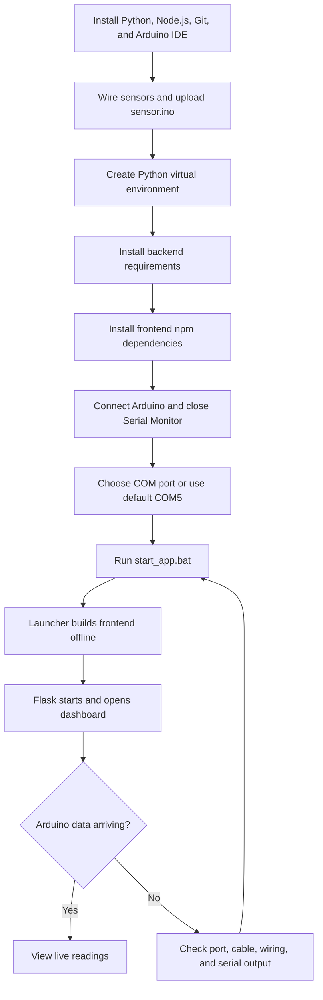

# Solar Guard

Solar Guard is a local IoT dashboard for monitoring the environment around a
solar panel. An Arduino UNO reads a DHT11, an LDR, a rain sensor, and an analog
voltage input, then sends JSON readings to a Python backend over USB serial.
The backend stores readings in SQLite and serves a React dashboard in your
browser.

The system is designed to run locally. It does not need an ESP32, Wi-Fi, a
cloud account, or a hosted database. Internet access is needed for the initial
dependency installation unless the packages are already available locally.

> **Measurement note:** The dashboard's estimated performance index is a
> relative project indicator calculated from the LDR light percentage and the
> A2 input voltage. It is not a measurement of actual solar-panel efficiency.
> Do not connect a panel voltage that can exceed the Arduino UNO's 5 V analog
> input limit directly to A2.

## Contents

- [Features](#features)
- [Architecture](#architecture)
- [Workflow](#workflow)
- [Methodology](#methodology)
- [Technology stack](#technology-stack)
- [Project structure](#project-structure)
- [Hardware and wiring](#hardware-and-wiring)
- [Prerequisites](#prerequisites)
- [Setup and run from PowerShell](#setup-and-run-from-powershell)
- [Development commands](#development-commands)
- [Serial protocol and API](#serial-protocol-and-api)
- [Database](#database)
- [Troubleshooting](#troubleshooting)
- [Offline operation](#offline-operation)

## Features

- Live sensor dashboard for light, rain, input voltage, temperature, and
  humidity.
- Arduino communication over USB serial at 9600 baud.
- JSON-lines sensor protocol, with support for the backend's legacy
  three-value CSV input format.
- Local SQLite history; no database server is required.
- Serial-port reconnect handling and configurable COM-port selection.
- Flask API endpoints for the latest reading and recent history.
- React dashboard served by Flask in the normal production run mode.
- Vite development server and npm lint/build scripts.
- Optional local MP4 background video with a CSS fallback.

## Architecture

### System architecture



The Arduino writes one JSON object followed by a newline about every two
seconds. A background thread in Flask reads the serial stream, validates
numeric values, and stores each valid reading in `backend/sensor_data.db`.
The browser requests the API once per second. During a normal run, Flask also
serves the built React app at `http://localhost:5000/`.

### Reading lifecycle



## Workflow

### First-time setup and launch



### Development workflow

1. Edit and upload `arduino/sensor.ino` using Arduino IDE.
2. Update the Flask serial parser or API in `backend/app.py` if the data
   contract changes.
3. Update the dashboard in `frontend/src/App.jsx` and its styles in
   `frontend/src/App.css`.
4. Run the backend and Vite development server in separate terminals.
5. Verify the API response and the live dashboard.
6. Run the frontend linter and production build before sharing changes.

## Methodology

1. **Acquire:** The sketch samples its connected sensors and emits one
   newline-terminated JSON object every two seconds over USB serial. The
   firmware uses 9600 baud.
2. **Parse and validate:** The backend reads serial lines, converts sensor
   values to finite numbers or `null`, and ignores malformed readings. It
   accepts extra numeric JSON fields so additional supported readings can be
   persisted without changing the database schema. A legacy CSV format with
   three values is also accepted.
3. **Persist:** Each valid reading is written to a local SQLite table with a
   timestamp. The database file is created automatically when the backend
   starts.
4. **Serve:** Flask exposes the latest record and up to 50 recent records as
   JSON. It also serves the production frontend from `frontend/dist`.
5. **Present:** React polls the latest-reading endpoint every second and
   updates the dashboard. When the serial feed is stale or unavailable, the
   interface reports the connection state instead of presenting old values
   as live.
6. **Recover:** The backend retries serial connections. Set `ARDUINO_PORT` to
   a specific COM port for a fixed device, or set it to `AUTO` to scan
   detected serial devices.

## Technology stack

| Layer | Technology | Purpose |
| --- | --- | --- |
| Microcontroller | Arduino UNO | Samples sensor inputs and sends JSON over USB |
| Firmware | Arduino C++ | Reads DHT11, analog, and digital sensor signals |
| Temperature/humidity library | Adafruit DHT sensor library | Reads the DHT11 module |
| Backend runtime | Python 3 | Serial reader, API, and database logic |
| Serial communication | pySerial | Finds and reads the Arduino COM port |
| Web API | Flask | Provides JSON endpoints and serves the built frontend |
| Cross-origin support | Flask-CORS | Allows the Vite development UI to call Flask |
| Database | SQLite via Python `sqlite3` | Stores sensor history locally |
| Frontend | React 19 | Renders the live dashboard |
| Frontend build/dev server | Vite 8 and `@vitejs/plugin-react` | Builds the dashboard and supports hot reload |
| 3D/visualization dependencies | Three.js, React Three Fiber, Drei | Frontend visualization dependencies |
| Frontend linting | oxlint | Checks frontend source |
| Launcher | Windows batch (`start_app.bat`) | Builds and starts the local app |

Python dependencies are listed in `backend/requirements.txt`. Frontend
dependencies and scripts are defined in `frontend/package.json` and pinned by
`frontend/package-lock.json`.

## Project structure

```text
iot-sensor-project/
├── README.md
├── .gitignore
├── package.json
├── package-lock.json
├── start_app.bat
├── arduino/
│   └── sensor.ino
├── backend/
│   ├── app.py
│   ├── requirements.txt
│   └── sensor_data.db        # created at runtime; do not commit local data
└── frontend/
    ├── index.html
    ├── package.json
    ├── package-lock.json
    ├── vite.config.js
    ├── public/
    │   └── Video Project 1.mp4
    └── src/
        ├── App.jsx
        ├── App.css
        └── main.jsx
```

Generated folders such as `.venv/`, `frontend/node_modules/`,
`frontend/dist/`, and `__pycache__/` are created locally and should not be
committed. The SQLite database is runtime data and should also remain
untracked.

## Hardware and wiring

### Required hardware

- Arduino UNO or compatible board.
- USB data cable.
- DHT11 module.
- LDR module.
- Rain sensor module with analog and digital outputs.
- Potentiometer or safe 0-5 V signal source for the A2 voltage input.
- Jumper wires.

### Pin mapping

| Sensor/module | Arduino connection | Dashboard data |
| --- | --- | --- |
| DHT11 | Data to D3; power and ground to module-rated pins | `temperature`, `humidity` |
| LDR | Analog output to A0 | `ldr`, `light_percent`, `daylight` |
| Rain module | Analog output to A1; digital output to D2 | `rain_analog`, `rain_digital`, `rain_detected` |
| Potentiometer / voltage input | Wiper to A2; outer pins to 5V and GND | `panel_voltage` |
| All modules | Common ground to Arduino GND | Required reference |

Check the voltage requirements for each module before wiring. Do not connect
an input above 5 V directly to an Arduino UNO analog pin. If measuring a
higher-voltage source, use a correctly rated voltage divider and a common
ground. The A2 input conversion assumes a 5 V ADC reference; with a
potentiometer it is a demonstration input rather than a calibrated panel
measurement.

Install **DHT sensor library by Adafruit** and **Adafruit Unified Sensor** in
Arduino IDE's Library Manager. Then:

1. Open `arduino/sensor.ino`.
2. Select the Arduino UNO board and its USB port.
3. Upload the sketch.
4. If checking output in Serial Monitor, set it to 9600 baud.
5. Close Serial Monitor before starting the backend; only one process can
   normally own a COM port at a time.

The sketch assumes a higher LDR ADC value means brighter light and that the
rain module's digital output is LOW when wet. Adjust
`BRIGHTER_WHEN_ADC_HIGHER`, `DAYLIGHT_ADC_THRESHOLD`, or
`RAIN_DETECTED_WHEN_DO_LOW` in `arduino/sensor.ino` to match your modules, then
upload the sketch again.

## Prerequisites

Install the following on Windows:

- Python 3 and the Python launcher (`py`), or a `python` command.
- Node.js LTS with npm; use a version supported by the installed Vite release.
- Arduino IDE and the two DHT libraries listed above.
- A USB serial driver if required by your Arduino-compatible board.
- Git, if cloning the repository.

Check that the tools are on `PATH` in PowerShell:

```powershell
py --version
python --version
node --version
npm --version
git --version
```

If `py` is unavailable but `python` works, use `python` instead of `py` in the
virtual-environment creation command below.

## Setup and run from PowerShell

Run these commands from the repository root. If you already have the
repository open, start at **Create the Python environment**.

### Optional: clone the repository

```powershell
git clone https://github.com/alitaufik990-dev/iot-sensor.git
Set-Location .\iot-sensor
```

### 1. Create the Python environment and install the backend

```powershell
py -m venv .venv
.\.venv\Scripts\python.exe -m pip install --upgrade pip
.\.venv\Scripts\python.exe -m pip install -r backend\requirements.txt
```

The virtual environment's Python executable is used directly, so activation is
not required. If you prefer to activate it in PowerShell:

```powershell
.\.venv\Scripts\Activate.ps1
python -m pip install --upgrade pip
python -m pip install -r backend\requirements.txt
```

If PowerShell blocks activation, continue using
`.\.venv\Scripts\python.exe` as in the first set of commands.

### 2. Install frontend dependencies

```powershell
npm --prefix frontend install
```

### 3. Select the Arduino serial port

The project defaults to `COM5`. If your board uses another port, set it in the
same PowerShell window before launching:

```powershell
$env:ARDUINO_PORT = "COM8"
```

Replace `COM8` with the port shown in Windows Device Manager. To ask the
backend to scan serial devices automatically instead:

```powershell
$env:ARDUINO_PORT = "AUTO"
```

To return to the default `COM5` behavior in the current terminal:

```powershell
Remove-Item Env:ARDUINO_PORT -ErrorAction SilentlyContinue
```

### 4. Start the production-style local app

Connect the Arduino, close Arduino IDE Serial Monitor, and run:

```powershell
.\start_app.bat
```

The launcher checks for the virtual environment and frontend dependencies,
builds the frontend using locally installed npm packages in offline mode, and
starts Flask. The backend opens `http://localhost:5000/` in your browser.
Keep the terminal open while using the dashboard; press `Ctrl+C` in that
terminal to stop the backend.

If the app cannot find the Arduino, check the configured COM port and USB
cable. The dashboard and API can start while the board is disconnected, but
they will report that live readings are unavailable.

## Development commands

Use two PowerShell terminals from the repository root.

**Terminal 1 - backend:**

```powershell
.\.venv\Scripts\python.exe backend\app.py
```

**Terminal 2 - Vite frontend:**

```powershell
npm --prefix frontend run dev
```

Open the URL printed by Vite, usually `http://localhost:5173/`. The Vite
frontend requests the Flask API at `http://127.0.0.1:5000`. Stop each process
with `Ctrl+C` in its terminal.

Useful frontend commands from the repository root:

```powershell
npm --prefix frontend run lint
npm --prefix frontend run build
npm --prefix frontend run preview
```

`build` creates `frontend/dist/`, which Flask serves in production mode.
`preview` starts Vite's local preview server after a successful build.

### Check that the backend is responding

With the backend running, query the latest sensor response:

```powershell
Invoke-RestMethod http://localhost:5000/api/sensor | ConvertTo-Json -Depth 5
```

Query up to 50 recent records:

```powershell
Invoke-RestMethod http://localhost:5000/api/history | ConvertTo-Json -Depth 5
```

The backend also opens the dashboard automatically when it starts. You can
open `http://localhost:5000/` or `http://localhost:5000/api/sensor` manually
in a browser.

## Serial protocol and API

The current Arduino sketch sends a JSON object every two seconds, for example:

```json
{
  "temperature": 23.0,
  "humidity": 45.0,
  "ldr": 610.0,
  "light_percent": 59.6,
  "panel_voltage": 2.5,
  "daylight": 1.0,
  "rain_analog": 810.0,
  "rain_digital": 1.0,
  "rain_detected": 0.0
}
```

DHT readings are `null` if the sensor does not provide a valid reading. The
backend stores the standard fields and any additional numeric fields under
`extra_sensors`.

| Endpoint | Method | Description |
| --- | --- | --- |
| `/api/sensor` | GET | Latest stored reading and serial connection status |
| `/api/history` | GET | Up to 50 most recent readings |
| `/` | GET | Production React app from `frontend/dist` |

The latest endpoint returns an object containing `api_version`, standard
sensor fields, `timestamp`, `connected`, `serial_port`, `configured_port`,
`available_ports`, and `extra_sensors`. When no reading has been saved yet,
sensor values and timestamp are `null` and `extra_sensors` is empty.

The backend defaults to `COM5` and 9600 baud. To override the COM port for
one PowerShell session, use `$env:ARDUINO_PORT = "COM8"` (or `AUTO` to scan).
The frontend polls the latest endpoint every second. The backend marks the
sensor connection inactive after five seconds without a valid reading.

## Database

The backend creates the SQLite database at:

```text
backend/sensor_data.db
```

The database is local and is initialized automatically when `app.py` starts.
Readings include the standard temperature, humidity, and distance columns,
the timestamp, and a JSON field for additional sensor values. This firmware
does not currently send a distance value, so it is normally `null`.

To back up the database while the app is stopped:

```powershell
Copy-Item backend\sensor_data.db backend\sensor_data.backup.db
```

To intentionally reset history, stop the app, back up any data you want to
keep, and then delete the database so it can be recreated at the next start:

```powershell
Remove-Item backend\sensor_data.db
```

Do not commit a local database containing personal or private data.

## Troubleshooting

### Dashboard says the Arduino is offline

1. Check the USB data cable and Windows Device Manager's **Ports (COM & LPT)**.
2. Set `$env:ARDUINO_PORT` to the correct COM port, or set it to `AUTO`.
3. Confirm the sketch is uploaded to the right board and uses 9600 baud.
4. Close Serial Monitor and any other program that could be using the COM port.
5. Check that the DHT and other sensors are wired to the pins in the table.
6. Wait for valid serial readings; the dashboard only marks live data online
   after a valid sensor line has arrived.

### `ModuleNotFoundError` for Flask or serial

Install the backend requirements into the project environment:

```powershell
.\.venv\Scripts\python.exe -m pip install -r backend\requirements.txt
```

### npm, Vite, or frontend dependencies are missing

Check Node.js and npm, then install frontend packages:

```powershell
node --version
npm --version
npm --prefix frontend install
```

### Port 5000 is already in use

Inspect the listening process before closing anything:

```powershell
Get-NetTCPConnection -LocalPort 5000 -State Listen
```

Do not terminate an unknown process. Stop the application that owns the port,
or configure this project and its frontend to use a different port together.

### Offline frontend build fails

The launcher uses `npm --offline run build`. This requires Node.js, installed
`frontend/node_modules`, and the needed packages in npm's local cache. While
online, install and build once:

```powershell
npm --prefix frontend install
npm --prefix frontend run build
```

### Video background does not load

Confirm `frontend/public/Video Project 1.mp4` exists. The video is decorative;
the dashboard has a fallback background and can still display sensor data
without it.

## Offline operation

After Python dependencies, npm dependencies, and Arduino libraries have been
installed:

- Sensor data moves over USB serial.
- Flask and SQLite run on the local computer.
- The production frontend is served from local build files.
- The launcher builds from installed local npm packages in offline mode.

Initial installation may require an internet connection. Normal monitoring
does not use a cloud service or require internet access.

## License

Add a license file and update this section before distributing the project
under an open-source license.
